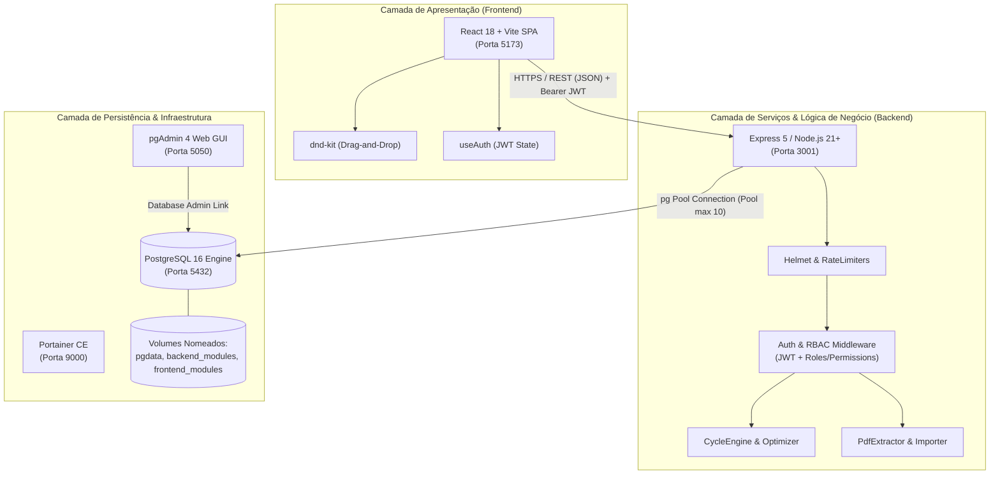

# 02. Arquitetura do Sistema e Stack Tecnológica

## 1. Visão Geral da Arquitetura

O **GSVR** adota uma arquitetura em camadas desacopladas (Client-Server / 3-Tier), orquestrada em microsserviços conteinerizados via **Docker Compose**:



---

## 2. Stack Tecnológica Detalhada

### 2.1. Frontend (Apresentação & Interação)
- **Framework Base:** [React 18](https://react.dev/) com Vite 6 (Single Page Application - SPA).
- **Gerenciamento de Estado & Hooks:** Hooks customizados (`useAuth.js`), estados reativos locais e sincronização via eventos globais de navegação.
- **Interação Drag-and-Drop:** `@dnd-kit/core` e `@dnd-kit/sortable` para montagem fluida de viaturas e patrulhas.
- **Ícones & Interface:** `lucide-react` para iconografia vetorial consistente.
- **Comunicação HTTP:** `axios` com interceptores para injeção automática de `Authorization: Bearer <token>` e tratamento global de expiração de sessão (status `401`).
- **Exportação e Renderização Documental:** `html2canvas` e `jspdf` para pré-visualização A4 em tela e geração de PDF de alta fidelidade para memorandos militares.
- **Manipulação de Datas:** `date-fns` para cálculo de fusos, intervalos e competências operacionais.

### 2.2. Backend (Lógica de Aplicação & APIs)
- **Plataforma de Execução:** [Node.js 21+](https://nodejs.org/) (ES Modules & CommonJS resiliente).
- **Servidor Web & Roteamento:** [Express 5](https://expressjs.com/).
- **Camada de Conexão com Banco:** Driver nativo `pg` (node-postgres) com `Pool` de conexões e suporte a transações ACID atômicas (`BEGIN`, `COMMIT`, `ROLLBACK`).
- **Criptografia & Assinatura:**
  - `bcrypt` (12 rounds de salt) para armazenamento de senhas.
  - `jsonwebtoken` (JWT) para emissão de tokens de sessão efêmeros (15 min) e `crypto` nativo para tokens SHA-256 e geração de chaves.
- **Segurança de Borda:** `helmet` para cabeçalhos HTTP protetivos e `express-rate-limit` para contenção de requisições maliciosas.
- **Processamento de Arquivos & Importação:**
  - `multer` com estratégias duplas: armazenamento em memória para planilhas e armazenamento em disco com validação de MIME type para avatares.
  - `xlsx` para leitura de matrizes de efetivo e histórico em planilhas Excel.
  - `pdf-parse` com heurísticas customizadas de OCR e extração estruturada de tabelas de requerimento em PDF.

### 2.3. Banco de Dados & Infraestrutura
- **SGBD:** [PostgreSQL 16](https://www.postgresql.org/), operando com integridade referencial nativa, índices compostos e gatilhos (triggers) de validação em nível de tabela.
- **Conteinerização:** `Docker Desktop 24+` e `Docker Compose v2`.
- **Gerenciamento de Containers:** `Portainer CE` para observabilidade e controle de containers em produção.
- **Painel Administrativo do Banco:** `pgAdmin 4` configurado com credenciais e rede interna isolada.

---

## 3. Padrões de Design e Decisões de Arquitetura (ADRs)

### 3.1. ADR-001: Persistência Manual de Escalas (No Premature Persistence)
- **Contexto:** Versões anteriores salvavam alterações de escala imediatamente ao soltar o card do militar na viatura. Qualquer arraste equivocado ou reorganização incompleta gravava dados temporários no banco e gerava inconsistências financeiras.
- **Decisão:** A montagem de escala no `AdminDashboardV2.jsx` ocorre estritamente em **memória volátil do cliente**. A persistência só é executada quando o operador clica expressamente no botão **"Salvar Escala"**, disparando uma transação unificada no backend.

### 3.2. ADR-002: Camada de Compatibilidade Bidirecional (Legacy Adapter)
- **Contexto:** O sistema original utilizava uma modelagem desnormalizada com campos JSON planos. A migração para a 3ª Forma Normal (3NF) com tabelas relacionais (`ESCALA_PLANEJAMENTO`, `ESCALA_EFETIVO_SERVICO`, `DISPONIBILIDADE_REQUERIMENTO`) poderia exigir uma reescrita massiva de 26 componentes do frontend.
- **Decisão:** O backend disponibiliza um adaptador transparente: recebe e consome a estrutura normalizada, mas projeta as consultas nos endpoints operacionais no formato que os componentes legados já consomem, garantindo **zero regressão de interface**.

### 3.3. ADR-003: Validação de Disponibilidade no Banco via Trigger
- **Contexto:** Mesmo com validações no frontend, chamadas manuais de API ou concorrência entre operadores poderiam tentar alocar um militar em dia/turno que ele não se voluntariou.
- **Decisão:** Foi criada a trigger `trg_valida_escala_insert` no PostgreSQL. Qualquer tentativa de inserção ou alteração de escala que aponte para um `id_disponibilidade` onde `marcado_disponivel = FALSE` ou `ativo = FALSE` é abortada no nível do SGBD com exceção `SQLSTATE 45000`.

---

## 4. Topologia de Rede e Portas dos Containers

O arquivo `docker-compose.yml` e `docker-compose.prod.yml` orquestram quatro serviços em uma rede interna isolada:

```
┌───────────────────────────────────────────────────────────┐
│                    REDE DOCKER: GSVR-NET                  │
│                                                           │
│  [frontend]  : Porta 5173  (Vite Dev / Nginx)             │
│  [backend]   : Porta 3001  (Node Express API)             │
│  [postgres]  : Porta 5432  (PostgreSQL 16 Engine)         │
│  [pgadmin]   : Porta 5050  (Painel Web de Administração)  │
│  [portainer] : Porta 9000  (Gestão de Recursos Docker)    │
└───────────────────────────────────────────────────────────┘
```

### Isolamento de Volumes
Para prevenir que dependências compiladas em sistemas operacionais locais (como Windows x64) colidam com os binários Linux dos containers, os diretórios `node_modules` residem exclusivamente em **volumes anônimos/nomeados do Docker**, enquanto o código fonte é sincronizado via bind mounts para garantir suporte a Hot Module Replacement (HMR).
