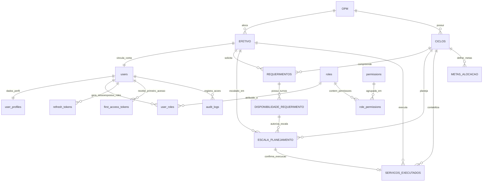

# 03. Modelagem de Dados e Esquema Relacional

## 1. Visão Geral da Modelagem

O banco de dados do **GSVR** foi projetado sob a 3ª Forma Normal (3NF) no **PostgreSQL 16**. Ele é dividido em quatro núcleos lógicos fundamentais:
1. **Núcleo Institucional & Pessoal**: Cadastro de OPMs e Militares (`OPM`, `EFETIVO`).
2. **Núcleo de Ciclos & Escalas Operacionais**: Ciclos, Requerimentos de Voluntariado, Disponibilidades, Planejamento e Serviços Executados.
3. **Núcleo de Controle de Acesso (RBAC) & Perfis**: Usuários, Perfis, Papéis, Permissões e Associação M:N.
4. **Núcleo de Segurança, Tokens & Auditoria**: Tokens efêmeros, bloqueios e trilha de auditoria imutável.

---

## 2. Diagrama Entidade-Relacionamento (Mermaid ERD)



---

## 3. Dicionário de Dados — Tabelas Operacionais

### 3.1. `OPM` (Organizações Policiais Militares)
Armazena as unidades subordinadas e sedes de batalhão.
- `id_opm` (SERIAL PRIMARY KEY): Identificador unívoco da OPM.
- `descricao` (VARCHAR(255) NOT NULL): Nome completo (ex: "9º Batalhão de Polícia Militar").
- `sigla` (VARCHAR(50) NOT NULL): Sigla operacional (ex: "9º BPM", "1ª CIA", "PEL DELMIRO").
- `endereco`, `telefone`, `email`: Dados de contato e endereço físico.

### 3.2. `EFETIVO` (Cadastro de Militares)
Tabela mestra contendo todos os militares registrados para atuação no SVR.
- `id_militar` (SERIAL PRIMARY KEY): Identificador do policial.
- `nome_completo` (VARCHAR(255) NOT NULL): Nome civil completo.
- `nome_guerra` (VARCHAR(100)): Nome de identificação na farda.
- `posto_graduacao` (VARCHAR(50) NOT NULL): Posto ou graduação (ex: "SD PM", "CB PM", "3º SGT PM", "CAP PM").
- `matricula` (VARCHAR(50) UNIQUE NOT NULL): Matrícula funcional no Estado.
- `numero_ordem` (VARCHAR(50)): Número de ordem utilizado em folhas e escalas.
- `cpf` (VARCHAR(14) UNIQUE NOT NULL): Cadastro de Pessoa Física (11 dígitos normalizados).
- `rgpm` (VARCHAR(20)): Registro Geral da Polícia Militar.
- `opm` (VARCHAR(100)): Sigla da OPM de lotação ordinária.
- `telefone` (VARCHAR(50)): Contato móvel com WhatsApp.
- `motorista` (BOOLEAN DEFAULT FALSE): Indica se o policial é habilitado e credenciado como condutor de viatura.
- `status_ativo` (BOOLEAN DEFAULT TRUE): Flag para militar ativo ou afastado/reserva.

### 3.3. `CICLOS` (Períodos Operacionais)
Períodos operacionais de execução orçamentária do SVR.
- `id_ciclo` (SERIAL PRIMARY KEY): Identificador do ciclo.
- `id_opm` (INTEGER REFERENCES OPM(id_opm)): OPM responsável pelo ciclo.
- `referencia_mes_ano` (VARCHAR(20) NOT NULL): Rótulo de referência (ex: "2026-07").
- `data_inicio` (DATE NOT NULL): Data inicial (geralmente dia 16).
- `data_fim` (DATE NOT NULL): Data final (geralmente dia 15 do mês seguinte).
- `status` (VARCHAR(50) NOT NULL): Situação do ciclo (`ABERTO`, `FECHADO`, `EM_PLANEJAMENTO`).
- `valor_total_previsto` (DECIMAL(12,2)): Verba total aprovada pelo escalão superior.
- `valor_contingencia` (DECIMAL(12,2) DEFAULT 0.00): Reserva técnica para emergências.
- `limite_equipes_diario` (INTEGER DEFAULT 6): Teto de viaturas/equipes por dia.

### 3.4. `REQUERIMENTOS` (Inscrição de Voluntariado)
Registro formal de solicitação de inscrição do militar em determinado ciclo.
- `id_requerimento` (SERIAL PRIMARY KEY): Identificador do requerimento.
- `id_militar` (INTEGER REFERENCES EFETIVO(id_militar)): Policial solicitante.
- `id_ciclo` (INTEGER REFERENCES CICLOS(id_ciclo)): Ciclo operacional pretendido.
- `numero_requerimento` (VARCHAR(50)): Protocolo gerado ou importado do SEI/PDF.
- `data_solicitacao` (TIMESTAMP DEFAULT CURRENT_TIMESTAMP): Data/hora de submissão.
- `arquivo_hash` (VARCHAR(64)): Hash SHA-256 do documento original para desduplicação.

### 3.5. `DISPONIBILIDADE_REQUERIMENTO` (Matriz de Turnos)
Matriz detalhada dia a dia e turno a turno das intenções de trabalho declaradas.
- `id_disponibilidade` (SERIAL PRIMARY KEY): Identificador único do slot de disponibilidade.
- `id_requerimento` (INTEGER REFERENCES REQUERIMENTOS(id_requerimento) ON DELETE CASCADE).
- `data_especifica` (DATE NOT NULL): Data correspondente no calendário (YYYY-MM-DD).
- `dia_mes` (INTEGER NOT NULL): Número do dia (1 a 31).
- `horario_turno` (VARCHAR(50) NOT NULL): Descrição do turno (ex: "07:00 ÀS 13:00").
- `marcado_disponivel` (BOOLEAN DEFAULT FALSE): `TRUE` se assinalado com "X" pelo policial.
- `marcado_servico_ordinario` (BOOLEAN DEFAULT FALSE): `TRUE` se escalado no serviço ordinário da OPM.
- `ativo` (BOOLEAN DEFAULT TRUE): Disponibilidade válida e ativa.
- `observacoes` (TEXT): Notas ou restrições de escala.

### 3.6. `ESCALA_PLANEJAMENTO` (Alocação em Equipes)
Armazena a montagem prévia das viaturas e guarnições planejadas.
- `id_escala` (SERIAL PRIMARY KEY): Identificador do registro de escala.
- `id_guarnicao` (VARCHAR(50)): Identificador da patrulha (ex: "FT-01", "FT-NOTURNO-CENTRO").
- `id_ciclo` (INTEGER REFERENCES CICLOS(id_ciclo)): Ciclo operacional.
- `id_militar` (INTEGER REFERENCES EFETIVO(id_militar)): Policial escalado.
- `id_disponibilidade` (INTEGER REFERENCES DISPONIBILIDADE_REQUERIMENTO(id_disponibilidade)): Vínculo estrito com o requerimento validado.
- `data_servico` (DATE NOT NULL): Data do serviço.
- `horario_servico` (VARCHAR(50) NOT NULL): Faixa horária do turno.
- `funcao` (VARCHAR(50) NOT NULL): Função na equipe (`COMANDANTE`, `MOTORISTA`, `PATRULHEIRO`).
- `cartao_viatura` (VARCHAR(100)): Prefixo da viatura (ex: "VTR-9102").
- `local_embarque` (VARCHAR(100)): Ponto de partida (ex: "Sede do 9º BPM").

### 3.7. `SERVICOS_EXECUTADOS` (Conferência e Faturamento)
Registro de serviços efetivamente cumpridos para fins de atesto e folha de pagamento.
- `id_execucao` (SERIAL PRIMARY KEY): Identificador do serviço executado.
- `id_ciclo` (INTEGER REFERENCES CICLOS(id_ciclo)): Ciclo ao qual pertence a verba.
- `id_militar` (INTEGER REFERENCES EFETIVO(id_militar)): Policial beneficiário.
- `id_escala` (INTEGER REFERENCES ESCALA_PLANEJAMENTO(id_escala) ON DELETE SET NULL): Escala de origem (preserva histórico se o planejamento for modificado).
- `data_execucao` (DATE NOT NULL): Data do cumprimento.
- `valor_remuneracao` (DECIMAL(10,2) NOT NULL): Valor apurado (R$ 192,03 ou R$ 250,00).
- `status_presenca` (VARCHAR(50) NOT NULL): Situação (`PRESENTE`, `FALTA_JUSTIFICADA`, `PERMUTA`, `FALTA_NAO_JUSTIFICADA`).

---

## 4. Dicionário de Dados — RBAC & Segurança

### 4.1. `users` (Contas de Acesso)
- `id` (SERIAL PRIMARY KEY): ID do usuário no sistema.
- `cpf` (VARCHAR(14) UNIQUE NOT NULL): CPF limpo (11 dígitos numéricos).
- `numero_ordem` (VARCHAR(50)): Matrícula ou número de ordem do policial.
- `password_hash` (TEXT): Hash bcrypt com custo 12.
- `status` (VARCHAR(20) DEFAULT 'ativo'): Situação (`ativo`, `inativo`, `bloqueado`).
- `senha_definida` (BOOLEAN DEFAULT FALSE): Flag de primeiro acesso.
- `primeiro_acesso_concluido` (BOOLEAN DEFAULT FALSE): Confirmação de setup de senha.
- `mfa_enabled` (BOOLEAN DEFAULT FALSE): Autenticação de dois fatores ativa (TOTP).
- `mfa_secret` (TEXT): Chave secreta Base32 do autenticador TOTP.
- `bloqueado` (BOOLEAN DEFAULT FALSE): Bloqueio temporário por tentativas falhas de login.
- `tentativas_falhas` (INTEGER DEFAULT 0): Contador de erros consecutivos de senha.
- `bloqueado_ate` (TIMESTAMP): Término do bloqueio temporário (15 minutos).
- `last_login_at` (TIMESTAMP): Carimbo de data/hora do último acesso bem-sucedido.

### 4.2. `roles` & `permissions`
- `roles`: `id`, `nome` (`ADMIN`, `GERENTE`, `MILITAR`, `SUPERUSER`), `descricao`, `is_sistema`.
- `permissions`: `id`, `code` (ex: `escalas:create`, `financeiro:read`, `usuarios:admin`), `descricao`, `modulo`.
- `user_roles`: Tabela associativa M:N vinculando `user_id` e `role_id`.
- `role_permissions`: Tabela associativa M:N vinculando `role_id` e `permission_id`.
- `user_permissions`: Permissões excepcionais diretas por usuário (com flag `permitido = TRUE/FALSE` para sobreposição).

### 4.3. `audit_logs` (Trilha de Auditoria Imutável)
- `id` (SERIAL PRIMARY KEY): Identificador do evento de auditoria.
- `user_id` (INTEGER REFERENCES users(id) ON DELETE SET NULL): Autor da ação.
- `cpf` (VARCHAR(14)): CPF do operador no momento do registro.
- `numero_ordem` (VARCHAR(50)): Matrícula ou número de ordem registrado.
- `action` (VARCHAR(100) NOT NULL): Identificador da ação (ex: `LOGIN_SUCCESS`, `LOGIN_FAILED`, `ACCOUNT_LOCKED`, `PASSWORD_RESET`, `SUPERUSER_ACTION`).
- `entity` (VARCHAR(100)): Entidade afetada (`users`, `escalas`, `ciclos`).
- `entity_id` (VARCHAR(100)): Identificador da entidade modificada.
- `details` (JSONB): Metadados complementares em formato estruturado JSON.
- `ip` (VARCHAR(45)): Endereço IP do solicitante (IPv4 ou IPv6).
- `user_agent` (TEXT): Navegador e plataforma do cliente.
- `status` (VARCHAR(20) DEFAULT 'SUCCESS'): Resultado do evento (`SUCCESS`, `FAILED`, `BLOCKED`).
- `created_at` (TIMESTAMP DEFAULT CURRENT_TIMESTAMP): Carimbo de tempo imutável.

---

## 5. Triggers de Integridade de Negócio

### Gatilho `trg_valida_escala_insert` (Integridade de Requerimento)
Garante em nível de transação SQL que nenhuma escala seja criada sem que o militar tenha assinalado expressamente a sua disponibilidade:

```sql
CREATE OR REPLACE FUNCTION fn_valida_escala()
RETURNS TRIGGER AS $$
DECLARE
    v_marcado_disponivel BOOLEAN;
    v_ativo BOOLEAN;
BEGIN
    SELECT marcado_disponivel, ativo 
    INTO v_marcado_disponivel, v_ativo
    FROM DISPONIBILIDADE_REQUERIMENTO
    WHERE id_disponibilidade = NEW.id_disponibilidade;

    IF v_marcado_disponivel IS NOT TRUE OR v_ativo IS NOT TRUE THEN
        RAISE EXCEPTION 'Erro: O militar não marcou este turno como disponível no requerimento ou a disponibilidade está inativa.'
        USING ERRCODE = '45000';
    END IF;
    RETURN NEW;
END;
$$ LANGUAGE plpgsql;

CREATE TRIGGER trg_valida_escala_insert
BEFORE INSERT OR UPDATE ON ESCALA_PLANEJAMENTO
FOR EACH ROW
EXECUTE FUNCTION fn_valida_escala();
```
