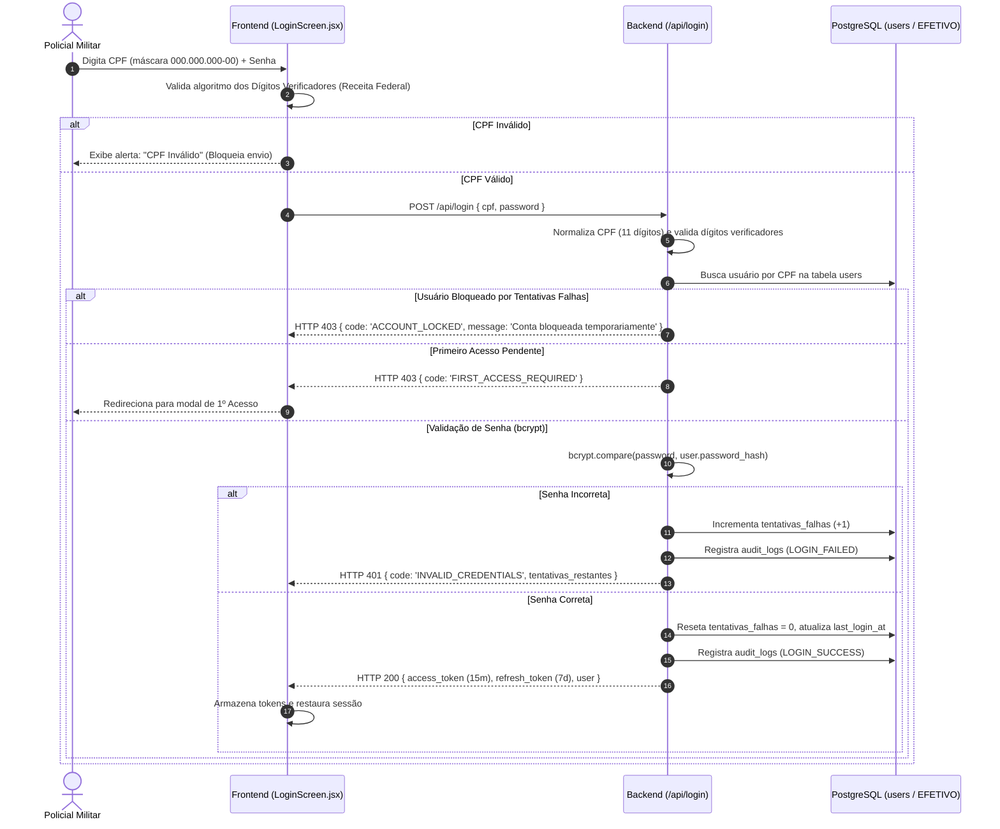
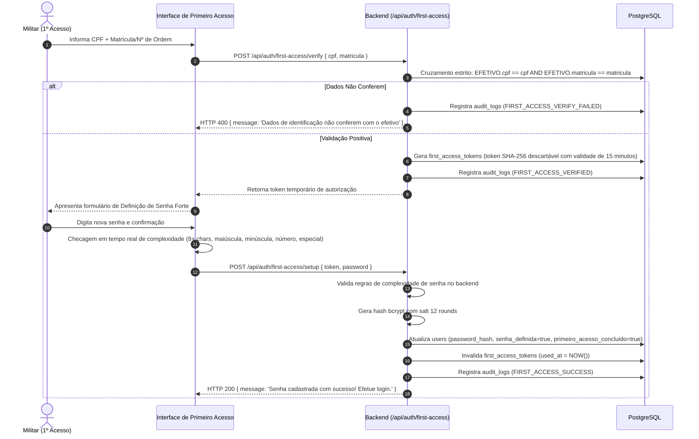

# 04. Segurança, Autenticação e Controle de Acesso

## 1. Princípios de Segurança do GSVR

A segurança do **GSVR** foi reformulada para atingir conformidade estrita com padrões corporativos e militares de defesa cibernética:
- **Autenticação Primária por CPF**: Eliminação do login genérico por matrícula ou senhas fracas.
- **Defesa Anti-Sequestro de Contas (Anti-Account-Hijacking)**: Validação cruzada no primeiro acesso.
- **Defesa em Profundidade**: Rate limiting, bloqueio de força bruta, proteção contra injeção SQL, cabeçalhos HTTP endurecidos (Helmet) e hashing criptográfico seguro.
- **Trilha de Auditoria Imutável**: Registro detalhado e persistente em banco de todos os eventos de segurança.

---

## 2. Fluxo de Autenticação por CPF

O acesso ao sistema utiliza exclusivamente o **CPF (Cadastro de Pessoa Física)** como identificador único primário:



### 2.1. Algoritmo de Validação de CPF
Implementado de forma idêntica e redundante no frontend (`utils/cpf.js`) e no backend (`backend/utils/cpf.js`), ele rejeita:
1. Strings com comprimento diferente de 11 dígitos numéricos;
2. Sequências conhecidas de dígitos repetidos (`00000000000`, `11111111111`, etc.);
3. Falhas nos cálculos aritméticos dos dois dígitos verificadores (módulo 11).

---

## 3. Fluxo de Primeiro Acesso com Defesa Anti-Sequestro

Em sistemas militares tradicionais, quando a senha padrão é o próprio CPF ou matrícula, qualquer operador de má-fé que obtenha o CPF de um colega pode registrar uma senha e assumir o controle da conta. 

Para anular essa vulnerabilidade, o GSVR implementa um **protocolo de desafio de conhecimento cruzado**:



---

## 4. Política Estrita de Complexidade de Senhas

O sistema rejeita senhas fracas. A função `validatePasswordRules()` impõe os seguintes requisitos mínimos:
- Comprimento mínimo de **8 caracteres**;
- Ao menos **uma letra maiúscula** (`A-Z`);
- Ao menos **uma letra minúscula** (`a-z`);
- Ao menos **um dígito numérico** (`0-9`);
- Ao menos **um caractere especial** (`!@#$%^&*()_+-=[]{};':"|,.<>/?`).

---

## 5. Controle de Acesso Baseado em Papéis (RBAC)

O controle de privilégios opera por verificação granular de permissões associadas a papéis:

### 5.1. Papéis de Sistema (`roles`)
| Papel | Finalidade | Nível de Acesso |
| :--- | :--- | :--- |
| **`MILITAR`** | Usuário padrão (Soldados, Cabos, Sargentos, Oficiais voluntários). | Acesso estrito a "Minhas Escalas" e envio de requerimento de voluntariado. |
| **`GERENTE`** | Operador da P/3 ou Seção de Planejamento Operacional. | Montagem de escalas, conferência e visualização de efetivo/relatórios. |
| **`ADMIN`** | Comandante de Batalhão, Subcomandante e Chefe da P/3. | Gestão total de ciclos, tipos de serviço, aprovação orçamentária e usuários. |
| **`SUPERUSER`** | Desenvolvedores e Administradores Técnicos da Plataforma. | Administração técnica irrestrita, auditoria, diagnósticos e suporte emergencial. |

### 5.2. Catálogo de Permissões Padronizadas
- **Módulo `escalas`**: `escalas:read`, `escalas:create`, `escalas:edit`, `escalas:delete`, `escalas:publish`.
- **Módulo `financeiro`**: `financeiro:read`, `financeiro:edit`, `financeiro:export`.
- **Módulo `ciclos`**: `ciclos:read`, `ciclos:create`, `ciclos:manage`.
- **Módulo `efetivo`**: `efetivo:read`, `efetivo:edit`, `efetivo:import`.
- **Módulo `opm`**: `opm:read`, `opm:manage`.
- **Módulo `usuarios`**: `usuarios:read`, `usuarios:create`, `usuarios:admin`, `usuarios:bloquear`, `usuarios:reset`, `usuarios:superuser`.
- **Módulo `sistema`**: `sistema:admin`, `sistema:audit`, `sistema:diagnostics`.

### 5.3. Middleware de Autorização (`authorize`)
A proteção de rotas no backend avalia se o requisitante possui a permissão requerida no token decodificado ou no banco:
```javascript
// Exemplo de proteção de rota
app.post('/api/escalas/planejamento', authenticate, authorize('escalas:create'), handleCreateEscala);
```
*Nota de Arquitetura:* Usuários com a role **SUPERUSER** possuem bypass de autorização transparente nos middlewares, garantindo acesso técnico integral sem necessidade de permissões estáticas hardcoded no código.

---

## 6. Perfil Técnico SUPERUSER e 2FA TOTP

Para evitar credenciais fixas ("backdoors") em arquivos fonte, o provisionamento de superusuários é efetuado estritamente via linha de comando no servidor:

```bash
# Provisionar superusuário com MFA obrigatório:
node backend/scripts/provision_superuser.js create --nome "Major Engenheiro" --cpf "00011122233" --matricula "DEV_01" --password "Senha@Forte2026" --mfa

# Listar superusuários ativos:
node backend/scripts/provision_superuser.js list

# Revogar perfil superusuário:
node backend/scripts/provision_superuser.js revoke --cpf "00011122233"
```

### Autenticação em Dois Fatores (TOTP RFC 6238)
- Geração de segredos Base32 exclusivos por superusuário;
- Compatível com Google Authenticator, Microsoft Authenticator e FreeOTP;
- Tolerância temporal de drift de 1 passo (30 segundos antes/depois);
- Obrigatório para login de desenvolvedores e superusuários caso `mfa_enabled = TRUE`.

---

## 7. Trilha de Auditoria Persistente (`audit_logs`)

Todas as ações críticas são gravadas de forma assíncrona e não-bloqueante na tabela `audit_logs`:
- **Ações Registradas**: `LOGIN_SUCCESS`, `LOGIN_FAILED`, `ACCOUNT_LOCKED`, `ACCOUNT_UNLOCKED`, `FIRST_ACCESS_VERIFIED`, `FIRST_ACCESS_SUCCESS`, `PASSWORD_CHANGE`, `ROLE_ASSIGNED`, `SUPERUSER_ACTION`, `CYCLE_STATUS_CHANGED`.
- **Dados Coletados**: ID do usuário, CPF, IP de origem, User-Agent, carimbo de tempo UTC e objeto estruturado `details` em formato **JSONB** para indexação e consultas rápidas.
- O painel técnico (`SuperUserDashboard.jsx`) disponibiliza visualização em tempo real dessa trilha com filtros por CPF, período e nível de severidade.
