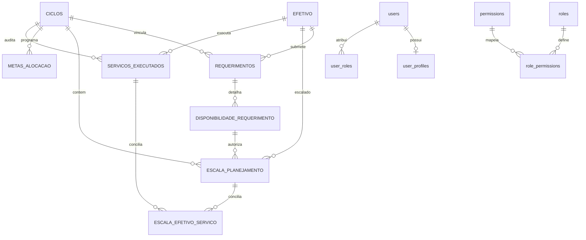

# ANÁLISE TÉCNICA COMPLETA E DOCUMENTAÇÃO DE ENGENHARIA DO SISTEMA GSVR
**Sistema de Gestão de Serviço Voluntário Remunerado — 9º Batalhão de Polícia Militar de Alagoas (9º BPM / PMAL)**

> **Documento Gerado:** 13 de Novembro de 2026  
> **Versão do Sistema Analisada:** `v1.37.0`  
> **Status:** Análise Técnica Completa e Exaustiva baseada em Inspeção Direta de Código-Fonte  
> **Classificação:** Documentação Oficial de Engenharia e Arquitetura

---

## 1. VISÃO GERAL DO SISTEMA

### 1.1. Finalidade Principal
O **GSVR (Gestão de Serviço Voluntário Remunerado)** é uma plataforma web corporativa de planejamento operacional, gestão de efetivo militar voluntário, escalonamento automatizado e controle financeiro/orçamentário desenvolvida sob medida para atender às necessidades do **9º Batalhão de Polícia Militar do Estado de Alagoas (9º BPM/PMAL)**, sediado em Delmiro Gouveia/AL e responsável pelo policiamento de 7 municípios do Alto Sertão alagoano.

A principal finalidade do sistema é substituir processos manuais, fragmentados e vulneráveis a inconsistências (planilhas avulsas, papéis físicos, mensagens em aplicativos de mensagens) por um ecossistema unificado e auditável. O sistema gerencia todo o ciclo de vida do Serviço Voluntário Remunerado: desde a manifestação de disponibilidade pelo policial voluntário (via formulário ou upload de requerimento padrão em PDF), passando pela conferência de conformidade, alocação em viaturas operacionais através de interface visual Drag-and-Drop, até a conciliação com os serviços efetivamente executados e emissão do mapa de gastos orçamentários para pagamento.

### 1.2. Problemas que o Sistema Soluciona
Antes da implementação do GSVR, a gestão do serviço voluntário enfrentava gargalos críticos:
1. **Violação do Teto Legal de Serviços:** Risco de alocação de policiais em mais de 8 serviços por ciclo mensal (limite legal improrrogável estabelecido pela legislação da PMAL).
2. **Duplicidade e Conflito de Escalas:** Falta de bloqueio automático permitia que um mesmo militar fosse escalado simultaneamente em turnos conflitantes ou em dias sem descanso regulamentar.
3. **Complexidade do Ciclo Temporal 16 a 15:** O ciclo operacional da PMAL não segue o mês civil (dia 01 ao dia 30/31), mas inicia-se no **dia 16 de um mês e se estende até o dia 15 do mês subsequente**. Um único requerimento mensal preenchido por um militar cobre duas metades de ciclos distintos, o que gerava erros sistemáticos na contagem manual de cotas.
4. **Discrepância Orçamentária entre Planejado e Executado:** Inconsistências entre o efetivo escalado pela Seção de Planejamento Operacional (P/3) e os policiais que efetivamente cumpriram a missão em campo, gerando passivos e divergências nas folhas de pagamento.
5. **Falta de Rastreabilidade e Auditoria:** Ausência de registros imutáveis sobre quem escalou, alterou, cancelou ou autorizou a participação de militares em serviços voluntários.

### 1.3. Público-Alvo e Perfis de Usuários
O GSVR atende a aproximadamente 400 policiais militares ativos no 9º BPM, distribuídos em 4 perfis de acesso bem definidos:
- **Policial Militar Voluntário (Perfil Operacional / Default):** Acessa o sistema via CPF para preencher e enviar sua disponibilidade de serviço (inscrição voluntária), consultar suas escalas confirmadas, visualizar detalhes de turno/viatura e imprimir seu comprovante mensal.
- **Operador P/3 (Planejamento Operacional / GERENTE):** Responsável por importar requerimentos físicos/digitais em PDF, gerenciar a disponibilidade dos militares, operar a tela de planejamento tático Drag-and-Drop, montar as guarnições de viaturas e publicar a Escala de Serviço Oficial.
- **Gestor Operacional / Financeiro (Fiscal do SVR):** Monitora as metas diárias de alocação (Cenários A e B), audita os relatórios de conciliação (Conferência Operacional), controla o teto orçamentário e exporta a Matriz Quantitativa de Gastos da Força-Tarefa.
- **Administrador do Sistema / SUPERUSER (TI / P/1 / Comando):** Controla o efetivo cadastrado, sincroniza dados de OPMs, parametriza datas dos ciclos operacionais, gerencia contas de usuários, papéis e permissões no modelo RBAC, além de acessar a central de segurança com logs de auditoria imutáveis e 2FA/TOTP.

### 1.4. Princípio Geral de Funcionamento
O ciclo de vida operacional no GSVR segue o fluxo lógico sequencial:
```
[1. Cadastro do Efetivo] ──> [2. Abertura do Ciclo (16 a 15)] ──> [3. Entrada de Requerimentos]
                                                                           │
                                                                           ▼
[6. Folha Financeira] <── [5. Execução & Conferência] <── [4. Planejamento Drag-and-Drop]
```
1. **Parametrização:** Abertura do ciclo operacional (ex: 16 de Outubro a 15 de Novembro) com orçamento previsto e limite diário de equipes.
2. **Captação de Voluntários:** Militares submetem suas disponibilidades via portal web ou enviam arquivos PDF gerados pelo modelo padrão da PMAL.
3. **Ingestão Inteligente (RequirementImporter):** O motor de backend processa os PDFs via `pdf-parse` e `PdfExtractor`, fragmentando automaticamente as marcações entre os ciclos vigentes (dias 16-31 no ciclo corrente, dias 01-15 no ciclo seguinte).
4. **Montagem da Escala (AdminDashboardV2):** O operador arrasta militares aptos para as viaturas (compostas obrigatoriamente por Comandante, Motorista e Patrulheiro), com travas visuais e bloqueios de banco de dados em tempo real contra excesso de cotas (>8) e indisponibilidade.
5. **Publicação e Notificação:** Geração de documento oficial em PDF formatado conforme os padrões regimentais da PMAL.
6. **Reconciliação e Fechamento:** Ao término do serviço, importa-se o arquivo de serviços executados para conciliação automática com o planejado através da tabela ternária `ESCALA_EFETIVO_SERVICO`.

### 1.5. Principais Módulos e Subsistemas
1. **Módulo de Identidade e Acesso (IAM / RBAC):** Autenticação por CPF, fluxo de Primeiro Acesso sem senha inicial, proteção contra força bruta, tokens JWT com rotação de refresh token, e 2FA TOTP para superusuários.
2. **Módulo de Efetivo Militar (P/1):** Gestão cadastral de militares, graduações, matrículas, vínculos com OPMs e importador em lote de planilhas Excel (`.xlsx`).
3. **Módulo Temporal (CycleEngine):** Motor matemático desacoplado responsável por calcular limites, competências e interseções de ciclos mensais quebrados (16 a 15).
4. **Módulo de Requerimentos & Parser de PDF:** Motor de processamento resiliente de documentos PDF com reconhecimento óptico de layout, detecção de turnos e marcações em grade.
5. **Módulo de Planejamento Tático (ScaleOptimizer & Drag-and-Drop):** Motor visual de montagem de equipes de viaturas baseado no toolkit `@dnd-kit`, sincronizado com regras financeiras de diárias (Cenários A e B).
6. **Módulo de Execução e Conferência:** Subsistema de conciliação entre o planejado e o realizado com gatilhos de banco de dados para integridade referencial cruzada.
7. **Módulo Orçamentário e Financeiro:** Cálculo de custos de diárias, previsão orçamentária, matriz de gastos e quantitativos de horas trabalhadas (6h vs 8h).
8. **Módulo de Auditoria e Diagnósticos:** Armazenamento imutável de eventos administrativos e telemetria de integridade do servidor.

---

## 2. LEVANTAMENTO COMPLETO DAS FUNCIONALIDADES

A análise de código identificou **90 endpoints REST** no backend (`backend/server.js`) e **27 componentes React** no frontend (`frontend/src/components/`), agrupados por domínios operacionais:

### 2.1. Autenticação, Identidade e Primeiro Acesso
- **Login por CPF com Algoritmo da Receita Federal:** Entrada unificada por CPF (sanitizado e validado numericamente via `isValidCPF`). Validações rigorosas impedem CPFs com dígitos repetidos ou cálculo incorreto de dígitos verificadores.
- **Primeiro Acesso Seguro:** Permite que militares recém-cadastrados definam sua senha pessoal sem necessidade de senha padrão inicial de fábrica. A validação exige combinação de CPF + Matrícula e gera um token descartável SHA-256 com validade de 15 minutos (`first_access_tokens`).
- **Autenticação em Duas Etapas (2FA / TOTP):** Implementação RFC 6238 nativa sem dependências externas (`backend/utils/totp.js`), exigida para superusuários. Suporta geração de segredo Base32, validação de token de 6 dígitos com janela de tolerância de drift temporal (±1 step).
- **Renovação Transparente de Sessão (Refresh Token):** Access token com expiração de 15 minutos e Refresh Token rotativo de 7 dias com hash SHA-256 armazenado em banco (`refresh_tokens`), revogado no logout ou em detecção de reuso.
- **Troca e Recuperação de Senha:** Fluxo de esquecimento de senha com tokens SHA-256 descartáveis com expiração de 12 horas (`password_reset_tokens`) e alteração autenticada com hash `bcrypt` (salt 12).
- **Bloqueio Progressivo contra Força Bruta:** Bloqueia automaticamente a conta após 5 tentativas consecutivas incorretas por 15 minutos (`tentativas_falhas`, `bloqueado_ate`).

### 2.2. Gestão de Efetivo Militar e OPMs
- **Cadastro e Edição de Policiais Militares:** Formulários de gestão de militares contendo Posto/Graduação (Coronel a Soldado), Nome Completo, Nome de Guerra, Matrícula, Número de Ordem, CPF, RGPM, OPM e Telefone.
- **Importação em Lote via Excel (.xlsx):** Parser integrado via biblioteca `xlsx` capaz de ler folhas de efetivo da PMAL, validar CPFs e matrículas, identificar duplicidades e cadastrar centenas de militares em transação única.
- **Lookup Instantâneo por Matrícula:** Endpoint `/api/efetivo/lookup/:matricula` para preenchimento automático em formulários.
- **Gestão de Organizações Policiais Militares (OPM):** CRUD completo de unidades militares (`OPM`), abrangendo sede do 9º BPM e companhias destacadas (Piranhas, Olho d'Água das Flores, etc.).

### 2.3. Gestão de Ciclos Operacionais e Metas
- **Ciclos Parametrizáveis (16 a 15):** Cadastro de períodos operacionais com data de início, data de término, status (`ABERTO`, `FECHADO`, `CANCELADO`), orçamento previsto e valor de contingência.
- **Configuração Dinâmica de Ciclo (`CICLO_CONFIG`):** Tabela que permite alterar o dia de início e término dos ciclos (padrão dia 16 a 15) sem alterar o código-fonte da aplicação.
- **Definição de Metas Diárias de Alocação (`METAS_ALOCACAO`):** Quantitativo de viaturas/equipes previstas para cada dia do ciclo, com segregação automática entre:
  - **Cenário A:** Dias úteis ordinários (Segunda a Quinta-feira, não feriados) — custo unitário da guarnição: R$ 576,09 (3 cotas de R$ 192,03).
  - **Cenário B:** Fins de semana (Sexta, Sábado, Domingo) e feriados nacionais/estaduais — custo unitário da guarnição: R$ 750,00 (3 cotas de R$ 250,00).
- **Cadastro de Feriados (`FERIADOS`):** Tabela que alimenta o motor de regras orçamentárias para classificar automaticamente feriados como Cenário B.

### 2.4. Gestão de Requerimentos e Motor de PDF
- **Inscrição Direta de Voluntário (`VolunteerForm.jsx`):** Interface para o próprio policial selecionar os turnos e dias do ciclo em que deseja concorrer à escala.
- **Importação em Lote de PDFs de Requerimentos (`RequerimentosAdmin.jsx`):** Aceita até 50 arquivos PDF simultâneos.
- **Motor de Extração Resiliente (`PdfExtractor.js`):** Extrai texto puro via `pdf-parse` e aplica expressões regulares em cascata para capturar Número de Ordem, Matrícula, Mês de Competência, Nome, Telefone, Habilitação como Motorista e grade de horários marcados com 'X'.
- **Fragmentação Inteligente de Ciclos (`RequirementImporter.js`):** Identifica que um requerimento de competência (ex: 11/2026) abrange o final do Ciclo Outubro/Novembro (dias 01 a 15) e o início do Ciclo Novembro/Dezembro (dias 16 a 30/31), vinculando cada marcação ao respectivo ciclo cadastrado no banco.
- **Cancelamento e Bloqueio de Disponibilidade:** Permite que o operador ou o militar desmarque disponibilidades previamente cadastradas, com rastreio de data de desistência.

### 2.5. Planejamento Operacional e Escalonamento Tático
- **Interface Drag-and-Drop (`AdminDashboardV2.jsx`):** O operador seleciona o ciclo e a data de serviço e visualiza o "Pool de Voluntários Aptos" à esquerda e as "Viaturas / Guarnições Operacionais" à direita. O arrasto de cards utiliza `@dnd-kit/core` e `@dnd-kit/sortable`.
- **Composição Obrigatória de Guarnição:** Cada viatura operacional comporta exatamente:
  - 1 Comandante de Guarnição (prioridade para Graduados: Subtenente, Sargentos).
  - 1 Motorista Policial (exigência estrita de habilitação operacional / campo `motorista = true`).
  - 1 Patrulheiro (Soldados e Cabos).
- **Travas Rígidas de Integridade (Banco e Frontend):**
  - Bloqueio de militares com 8 serviços atingidos no ciclo corrente (alerta visual vermelho e bloqueio no backend).
  - Bloqueio contra dupla escala no mesmo turno ou na mesma data.
  - Gatilho `fn_valida_escala()` rejeita inclusão de militares sem disponibilidade ativa marcada.
- **Otimizador Algorítmico de Escala (`ScaleOptimizationService.js`):** Algoritmo heurístico para preenchimento preliminar automático baseado em saldo orçamentário restante e priorização de menor número de escalas prévias.
- **Exportação de Escala para Publicação Oficial (`EscalaPublicacaoOficial.jsx`):** Gera grade padronizada em alta resolução e compila via `jspdf` e `html2canvas` com compressão JPEG (qualidade 0.82) para redução drástica do tamanho em MB sem perda de nitidez.

### 2.6. Execução de Serviços e Conferência
- **Cadastro de Serviços Realizados (`ServicosExecutadosManager.jsx`):** Registro pontual dos serviços que efetivamente aconteceram em campo.
- **Importação de Planilhas de Execução (`ServicosImport.jsx`):** Leitura de planilhas de conferência com detecção automática de horas (6h ou 8h) e classificação de feriados.
- **Painel de Conferência Operacional (`ConferenciaOperacional.jsx`):** Tela de conciliação que cruza a tabela `ESCALA_PLANEJAMENTO` com `SERVICOS_EXECUTADOS` através da tabela ternária `ESCALA_EFETIVO_SERVICO`. Apresenta cards visuais para:
  - Serviços Planejados e Confirmados (Casamento 100%).
  - Militares Faltosos (Planejado sem Execução registrada).
  - Militares Encaixados de Última Hora (Executado sem Planejamento prévio).
  - Discrepâncias de Carga Horária ou de Função.

### 2.7. Gestão Orçamentária e Financeira
- **Resumo Financeiro por Ciclo (`FinanceiroDashboard.jsx`):** Exibe total gasto, saldo orçamentário restante, custo por modalidade de serviço e distribuição entre Oficiais e Praças.
- **Matriz de Gastos da Força-Tarefa (`QuantitativoGastosFT.jsx`):** Matriz analítica interativa que divide os gastos por turnos de 6h e 8h, quantitativo de militares fora da sede do Batalhão, custo diário consolidado e botão de sincronização em tempo real com a escala planejada (`/api/ciclos/:id/gastos-matriz/sync-escala`).

### 2.8. Governança, RBAC e Auditoria
- **Controle de Acesso Baseado em Papéis (`RolesManager.jsx`):** Configuração granular de permissões atreladas a funções do sistema (`SUPERUSER`, `ADMIN`, `GERENTE`, `OPERADOR`, `MILITAR`).
- **Painel de Superusuário (`SuperUserDashboard.jsx`):** Acessível somente com validação 2FA, disponibiliza:
  - Trilha de Auditoria Imutável (`audit_logs`) com filtros por data, ação, CPF, entidade e status.
  - Telemetria de Integridade do Servidor (`/api/admin/diagnostics`): estatísticas de memória RAM do Node.js, tempo de atividade (uptime), integridade das conexões do pool PostgreSQL e contadores de tabelas.
  - Reset forçado de senhas e primeiro acesso de contas bloqueadas.

### 2.9. Classificação do Status de Implementação das Funcionalidades

| Funcionalidade / Componente | Arquivo Principal | Status Real | Observações de Código |
| :--- | :--- | :---: | :--- |
| Login CPF + Validador Receita | `backend/server.js`, `frontend/src/components/LoginScreen.jsx` | **Totalmente Implementado** | Algoritmo oficial de CPF ativo, proteção contra força bruta. |
| Primeiro Acesso sem Senha Padrão | `backend/server.js`, `LoginScreen.jsx` | **Totalmente Implementado** | Gera token SHA-256 descartável com expiração de 15 min. |
| Autenticação 2FA TOTP | `backend/utils/totp.js`, `SuperUserDashboard.jsx` | **Totalmente Implementado** | RFC 6238 nativo em Node.js com crypto. |
| Planejamento Visual Drag-and-Drop | `AdminDashboardV2.jsx` | **Totalmente Implementado** | 2.801 linhas de código, integração com `@dnd-kit`. |
| Importador de PDFs de Requerimentos | `RequirementImporter.js`, `RequerimentosAdmin.jsx` | **Totalmente Implementado** | Fragmentação automática entre 2 ciclos temporais. |
| Otimizador Algorítmico de Escalas | `ScaleOptimizationService.js` | **Totalmente Implementado** | Algoritmo heurístico funcional no backend. |
| Publicação Oficial em PDF Otimizado | `EscalaPublicacaoOficial.jsx` | **Totalmente Implementado** | Renderiza tabela oficial e exporta PDF leve via canvas/jsPDF. |
| Conferência Operacional Ternária | `ConferenciaOperacional.jsx`, `backend/db.js` | **Totalmente Implementado** | Triggers PL/pgSQL gerenciam conciliação automática. |
| Matriz Quantitativa de Gastos FT | `QuantitativoGastosFT.jsx` | **Totalmente Implementado** | Suporta sincronização direta com as escalas. |
| Relatório Operacional Antigo | `frontend/src/components/RelatorioOperacional.jsx` | **Desativado / Legado** | Não é montado em `App.jsx`; rotas antigas não existem no backend. |
| Relatório Individual por Militar | `frontend/src/components/RelatorioIndividual.jsx` | **Totalmente Implementado** | Usado internamente por `HistoricoMilitar.jsx`. |
| Portal Web de Documentação | `DocsPortal.jsx`, `manual-e-documentacao.html` | **Totalmente Implementado** | Visualizador de Markdown integrado no menu superior. |

---

## 3. ARQUITETURA E ESTRUTURA TECNOLÓGICA

### 3.1. Modelo Arquitetural Geral
O GSVR adota uma **Arquitetura 3-Tier (Três Camadas) Desacoplada e Modular**, estruturada da seguinte forma:
1. **Camada de Apresentação (Frontend):** Single Page Application (SPA) construída em **React 18** com empacotamento ultrarrápido via **Vite 6**. Todo o estado da aplicação é gerenciado no cliente, consumindo dados assincronamente através de APIs REST.
2. **Camada de Aplicação e Serviços de Negócio (Backend):** Servidor HTTP RESTful construído em **Node.js 21** sobre o framework **Express 5**, organizado em rotas, serviços de domínio desacoplados (`services/`) e middlewares de segurança/interceptação.
3. **Camada de Persistência e Dados (Database):** Banco de dados relacional **PostgreSQL 16**, encarregado não apenas do armazenamento das tabelas, mas da garantia rígida de consistência das regras de negócio através de Foreign Keys, Triggers PL/pgSQL e Views analíticas.

```mermaid
flowchart TD
    subgraph Cliente["Navegadores Clientes (Operador / Policial)"]
        UI["SPA React 18 + Vite (Tailwind / Lucide)"]
    end

    subgraph Borda["Camada de Borda & Roteamento"]
        NPM["Nginx Proxy Manager / Certbot (SSL/TLS Let's Encrypt)"]
    end

    subgraph BackendApp["Servidor de Aplicação (Node.js 21)"]
        EXP["Express 5 REST API"]
        AUTH["Auth & JWT / RBAC / TOTP RFC 6238"]
        ENG["CycleEngine & PdfExtractor"]
        OPT["ScaleOptimizationService"]
    end

    subgraph Dados["Banco de Dados Relacional"]
        PG[("PostgreSQL 16\n(25 Tabelas, 5 Triggers, 3 Views)")]
    end

    UI -->|HTTPS:443| NPM
    NPM -->|HTTP:5173| UI
    NPM -->|HTTP:3001| EXP
    EXP --> AUTH
    EXP --> ENG
    EXP --> OPT
    EXP -->|Pool pg (SQL nativo parametrizado)| PG
```

### 3.2. Topologia de Rede e Roteamento
A aplicação foi arquitetada para operar tanto em **Rede Local Interna** quanto via **Acesso Remoto Externo com IP Fixo**:
- **Resolução Dinâmica de API (`frontend/src/utils/apiConfig.js`):** O frontend detecta automaticamente a origem da navegação. Quando acessado via subdomínio (ex: `gsvr.192.168.1.18.nip.io` ou `gsvr.45.234.245.204.nip.io:36419`), redireciona as requisições de API para o subdomínio correspondente (`api.192.168.1.18.nip.io` ou `api.45.234.245.204.nip.io:36419`), mantendo a porta e o protocolo intactos sem necessidade de rebuild do frontend.
- **Interceptador Axios com Fila de Espera (`frontend/src/utils/axiosSetup.js`):** Intercepta erros HTTP `401 Unauthorized` e realiza renovação transparente com o Refresh Token. Enquanto o refresh ocorre, requisições paralelas entram em uma fila (`failedQueue`) e são despachadas assim que o novo token é emitido.

### 3.3. Estrutura de Diretórios e Organização
```
GSVR/
├── backend/                        # Servidor Node.js / Express
│   ├── middleware/                 # Interceptadores (Upload Multer, etc.)
│   ├── migrations/                 # Scripts SQL de evolução estrutural
│   ├── scripts/                    # Scripts utilitários e de provisionamento
│   ├── services/                   # Motores de negócio desacoplados (Cycle, PDF, Scale)
│   ├── utils/                      # CPF, TOTP RFC 6238, Auditoria
│   ├── db.js                       # Configuração do Pool PG, DDL e Triggers
│   ├── server.js                   # 90 Endpoints REST e Inicialização
│   └── Dockerfile                  # Container Node.js 21 Alpine
├── frontend/                       # Aplicação Web React 18 / Vite
│   ├── public/                     # Assets estáticos e Portal Manual HTML
│   ├── src/
│   │   ├── assets/                 # Imagens, logotipos militares e ícones
│   │   ├── components/             # 27 Componentes de Tela e Modais
│   │   ├── hooks/                  # Hooks customizados (useAuth)
│   │   ├── utils/                  # apiConfig, axiosSetup, formatters, cpf
│   │   ├── App.jsx                 # Barramento de Navegação e Controle de Telas
│   │   ├── App.css / index.css     # Estilos globais e tokens de cores
│   │   └── main.jsx                # Ponto de entrada React DOM
│   └── Dockerfile                  # Container Frontend Vite Dev/Prod
├── docs/                           # Documentação Técnica e Manuais Operacionais
│   ├── 01 a 08 volumes modulares   # Documentação completa dos módulos
│   ├── README.md                   # Índice e Guia Rápido
│   └── VERSION.md                  # Histórico de Versões e Changelog
├── docker-compose.yml              # Orquestração do ambiente de desenvolvimento
├── docker-compose.prod.yml         # Orquestração do ambiente de produção (VPS)
└── deploy_ssh.py / deploy_sftp.py  # Automação de deploy contínuo via SSH
```

---

## 4. BANCO DE DADOS E GERENCIAMENTO DE INFORMAÇÕES

### 4.1. SGBD e Configuração de Conexão
- **SGBD:** PostgreSQL versão `16.x` (imagem oficial `postgres:16-alpine`).
- **Conector de Banco:** Driver nativo `pg` (node-postgres v8.12.0) operando com pool de conexões com limites dinâmicos, timeout de requisição e encerramento gracioso.
- **Estratégia de Persistência:** Queries em SQL nativo parametrizado (`$1, $2, ...`) para impedir qualquer tipo de injeção de SQL (SQL Injection). Não utiliza ORM intermediário pesado, garantindo máxima performance e total controle sobre as queries e planos de execução.

### 4.2. Dicionário de Dados e Entidades (25 Tabelas)



#### Relação Detalhada das Tabelas do Sistema:
1. `OPM`: Organizações Policiais Militares (id_opm, descricao, sigla, endereco, telefone, email).
2. `EFETIVO`: Militares cadastrados (id_militar, nome_completo, nome_guerra, posto_graduacao, matricula, numero_ordem, cpf, rgpm, opm, telefone, status_ativo).
3. `CICLOS`: Ciclos mensais 16 a 15 (id_ciclo, id_opm, data_inicio, data_fim, status, valor_total_previsto, valor_contingencia, ativo).
4. `CICLO_CONFIG`: Parametrização temporal flexível do dia de corte dos ciclos (id_config, dia_inicio, dia_fim, id_opm, vigente_desde).
5. `METAS_ALOCACAO`: Metas diárias de viaturas por ciclo (id_meta, id_ciclo, data, cenario, qtd_equipes_planejadas, custo_estimado).
6. `TIPOS_SERVICO`: Modalidades de escalas (id_tipo_servico, descricao, carga_horaria, valor_remuneracao, ativo).
7. `REQUERIMENTOS`: Cabeçalho dos requerimentos de voluntários (id_requerimento, id_militar, id_ciclo, id_usuario_criacao, numero_requerimento, data_solicitacao, observacao).
8. `DISPONIBILIDADE_REQUERIMENTO`: Slots de dias e turnos marcados pelos voluntários (id_disponibilidade, id_requerimento, dia_mes, horario_turno, marcado_disponivel, marcado_servico_ordinario, motorista, ativo).
9. `ESCALA_PLANEJAMENTO`: Escalas geradas pelo P/3 (id_escala, id_guarnicao, id_ciclo, id_militar, id_disponibilidade, id_tipo_servico, data_servico, horario_servico, viatura, funcao_guarnicao, observacoes).
10. `SERVICOS_EXECUTADOS`: Efetivo cumprimento do serviço operacional (id_execucao, id_ciclo, id_militar, id_tipo_servico, data_execucao, dia_semana, eh_feriado, carga_horaria, valor_diaria, publicado_boletim).
11. `ESCALA_EFETIVO_SERVICO`: Tabela ternária de conciliação de presença (id_vinculo, id_escala, id_militar, id_execucao, status, data_vinculo, editado_em).
12. `PLANILHA_GASTOS_FT`: Matriz consolidada de gastos financeiros da Força-Tarefa por ciclo (id_ciclo, dados_matriz, valor_total_ft, pm_fora_6h, pm_fora_8h, created_at, updated_at).
13. `FERIADOS`: Calendário de feriados para acionamento do Cenário B (id_feriado, data, descricao).
14. `IMPORTACAO_LOG`: Histórico de auditoria de uploads de PDFs e planilhas (id_log, id_usuario, arquivo_nome, arquivo_hash, status, id_militar, id_requerimento, ciclos_afetados, mensagem_erro).
15. `users`: Contas de autenticação (id, numero_ordem, cpf, password_hash, is_admin, senha_definida, primeiro_acesso_concluido, mfa_enabled, mfa_secret, bloqueado, tentativas_falhas, bloqueado_ate).
16. `user_profiles`: Dados de perfil estendido (id, user_id, email, telefone, avatar_url, avatar_filename, status_ativo, deleted_at).
17. `first_access_tokens`: Tokens de segurança do primeiro acesso (id, user_id, token_hash, expires_at, used_at, ip_solicitante).
18. `password_reset_tokens`: Tokens de recuperação de senha (id, user_id, token_hash, expires_at, used_at, ip_solicitante).
19. `refresh_tokens`: Sessões ativas de JWT (id, user_id, token_hash, expires_at, revoked_at, ip_criacao, user_agent).
20. `roles`: Funções do sistema RBAC (id, nome, descricao, is_sistema).
21. `permissions`: Catálogo de permissões granulares (id, code, descricao, modulo).
22. `role_permissions`: Mapeamento entre papéis e permissões (role_id, permission_id).
23. `user_roles`: Atribuição de papéis aos usuários (user_id, role_id, atribuido_por).
24. `user_permissions`: Permissões personalizadas diretas por usuário (user_id, permission_id, permitido).
25. `audit_logs`: Livro-caixa imutável de eventos de auditoria (id, user_id, cpf, numero_ordem, action, entity, entity_id, details, ip, user_agent, status, created_at).

### 4.3. Procedimentos, Gatilhos e Views
O banco de dados do GSVR executa lógica operacional ativa através de 5 triggers e 3 views:
- **Trigger `trg_valida_escala_insert` / `update` (`fn_valida_escala`):** Impede a inserção de escala caso o militar não possua disponibilidade formal marcada ou caso seu registro esteja inativo na tabela `DISPONIBILIDADE_REQUERIMENTO`.
- **Trigger `trg_valida_vinculo_planejamento_execucao` (`fn_valida_vinculo_planejamento_execucao`):** Lança exceção e cancela a transação (`RAISE EXCEPTION`) se houver divergência de datas entre o serviço planejado e o serviço executado vinculado.
- **Triggers de Conciliação Automática (`trg_planejamento_after_insert` e `trg_execucao_after_insert`):** Sempre que uma escala é planejada ou um serviço executado é importado, as funções `trg_planejamento_ternaria()` e `trg_execucao_ternaria()` buscam automaticamente sua contraparte e realizam o cruzamento de presença na tabela `ESCALA_EFETIVO_SERVICO`.
- **View `vw_detalhes_ciclos`:** Agrega quantitativo de militares, total de serviços planejados, total de executados e saldo financeiro por ciclo.
- **Views `vw_relatorio_operacional_completo` e `vw_relatorio_operacional_agregado`:** Visões analíticas desnormalizadas para exportação de estatísticas do efetivo e geração de históricos.

---

## 5. INTERFACE E EXPERIÊNCIA DO USUÁRIO (UI/UX)

### 5.1. Padrões Visuais e Design System
- **Paleta de Cores e Identidade Institucional:** A interface adota estética militar moderna e sóbria ("Dark Navy & Tactical Slate"). Cores primárias baseadas em Azul Marinho Profundo (`#0f172a`, `#1e293b`), Azul Aço (`#1d4ed8`, `#2563eb`), Realce Ciano (`#38bdf8`) e Indicadores Semânticos padrão (Verde Esmeralda para Disponível/Confirmado, Âmbar para Alertas/Metas, Vermelho Carmim para Bloqueios/Faltas).
- **Tipografia e Densidade de Informação:** Utiliza tipografia de alta legibilidade (`Inter`, `-apple-system`, `system-ui`) com tabelas condensadas e cards otimizados para alta densidade de dados, facilitando a visualização simultânea de dezenas de guarnições operacionais.
- **Iconografia Consistente:** Padronização completa através da biblioteca `lucide-react` (escudos, viaturas, calendário, usuários, checagens, travas).

### 5.2. Componentes e Telas Disponíveis (27 Componentes)
1. `AdminDashboardV2.jsx`: Centro de comando operacional de planejamento tático Drag-and-Drop.
2. `LoginScreen.jsx`: Portal de autenticação por CPF, primeiro acesso, redefinição de senha e MFA.
3. `MinhasEscalas.jsx`: Portal do policial militar para consulta das suas próprias escalas e cancelamento.
4. `VolunteerForm.jsx`: Formulário digital para inscrição direta de voluntários.
5. `RequerimentosAdmin.jsx`: Central de gestão e importação em lote de requerimentos em PDF.
6. `EscalaPublicacaoOficial.jsx`: Gerador e exportador de escalas oficiais em PDF formatado.
7. `ConferenciaOperacional.jsx`: Painel de reconciliação entre planejado e executado.
8. `QuantitativoGastosFT.jsx`: Matriz de custos e quantitativo orçamentário da Força-Tarefa.
9. `FinanceiroDashboard.jsx`: Dashboard analítico de despesas e orçamento.
10. `AnalyticsDashboard.jsx`: Indicadores de performance, rankings de voluntários e estatísticas operacionais.
11. `HistoricoMilitar.jsx`: Histórico consolidado de participação do policial militar.
12. `RelatorioIndividual.jsx`: Comprovante individual de serviços executados para impressão.
13. `EfetivoManager.jsx`: CRUD de policiais militares ativos.
14. `EfetivoImport.jsx`: Importação de efetivo via planilha Excel (.xlsx).
15. `ServicosExecutadosManager.jsx`: CRUD de serviços executados em campo.
16. `ServicosImport.jsx`: Importação em lote de planilhas de execução de serviço.
17. `CicloManager.jsx`: Gestão e abertura de ciclos mensais (16 a 15).
18. `MetasAlocacaoManager.jsx`: Definição de metas de viaturas e custos por dia.
19. `TiposServicoManager.jsx`: Gestão de tipos de escala (6h, 8h, valores de diárias).
20. `OpmManager.jsx`: Gestão das unidades militares e subunidades do 9º BPM.
21. `UserManager.jsx`: Gestão de contas de usuários, reativação e status.
22. `RolesManager.jsx`: Gestão de perfis e permissões granulares no modelo RBAC.
23. `SuperUserDashboard.jsx`: Painel de controle do Superusuário, trilha de auditoria e telemetria.
24. `ProfilePage.jsx`: Edição de perfil do usuário logado, telefone, e-mail e foto de avatar.
25. `DocsPortal.jsx`: Visualizador integrado de manuais e documentação técnica.
26. `Footer.jsx`: Rodapé institucional com créditos da Seção de Tecnologia do 9º BPM.
27. `RelatorioOperacional.jsx`: Componente legado de visualização de relatórios agregados.

### 5.3. Avaliação de Usabilidade e Responsividade
- **Operação em Desktop (Foco Principal):** A experiência em desktops e monitores widescreen (1920x1080 ou superior) é excelente. O Drag-and-Drop em duas colunas com barra lateral colapsável permite ao operador P/3 montar a escala de um mês inteiro em minutos.
- **Operação em Dispositivos Móveis (Tablets / Smartphones):** As telas do militar voluntário (`MinhasEscalas.jsx`, `VolunteerForm.jsx`, `ProfilePage.jsx`, `LoginScreen.jsx`) são plenamente responsivas e utilizam layouts verticais adaptativos. As telas analíticas complexas (`AdminDashboardV2.jsx`, `QuantitativoGastosFT.jsx`) exigem rolagem horizontal quando abertas em telas pequenas, o que é natural pela natureza de planilhas de comando e controle.

---

## 6. INFRAESTRUTURA E IMPLANTAÇÃO

### 6.1. Topologia de Servidores e Virtualização
O GSVR opera em infraestrutura híbrida com suporte a implantação em Docker e execução nativa em servidores Linux/Windows:
- **Servidor de Produção (VPS Dedicado):**
  - Host: Servidor Linux Ubuntu (IP interno `192.168.1.18`, IP externo `45.234.245.204`).
  - Orquestração: **Docker Compose v2** (`docker-compose.prod.yml`).
  - Container `ft-postgres-prod`: PostgreSQL 16 Alpine com volume persistente montado em `pgdata_prod`.
  - Container `ft-backend-prod`: Node.js 21 Alpine rodando o servidor Express na porta interna 3001.
  - Container `ft-frontend-prod`: Node.js 21 servindo o frontend compilado na porta 5173.
  - Container `ft-pgadmin-prod`: Interface pgAdmin 4 na porta 5050 para auditoria e suporte de banco.
  - Proxy Reverso / SSL: Nginx Proxy Manager (NPM) gerenciando certificados SSL Let's Encrypt para os domínios `gsvr.192.168.1.18.nip.io` e `api.192.168.1.18.nip.io`.

### 6.2. Ambientes e Variáveis de Configuração
- **Backend (`backend/.env` e `backend/.env.docker`):**
  - `PORT=3001`
  - `DB_USER=postgres`
  - `DB_PASSWORD=******`
  - `DB_NAME=escala_ft`
  - `DB_HOST=postgres` (ou `localhost` em dev)
  - `DB_PORT=5432`
  - `JWT_SECRET=******`
  - `JWT_EXPIRES_IN=15m`
  - `REFRESH_TOKEN_EXPIRES_IN=7d`
- **Frontend (`frontend/.env`):**
  - `VITE_API_URL=http://localhost:3001` (com resolução dinâmica em runtime no navegador via `apiConfig.js`).

### 6.3. Esteira de Deploy Contínuo (CI/CD)
O projeto conta com scripts automatizados em Python/Paramiko (`deploy_ssh.py`, `deploy_sftp_ssh.py`):
1. Conexão SSH segura com a VPS de produção.
2. Transferência diferencial via SFTP de arquivos alterados (backend, frontend, documentação).
3. Execução remota de recriação de containers: `docker compose -f docker-compose.prod.yml up -d --build`.
4. Verificação de integridade pós-deploy (healthcheck HTTP e verificação de versão ativa).

---

## 7. SEGURANÇA E CONFIABILIDADE

### 7.1. Mecanismos de Autenticação e Autorização Granular (RBAC)
- **Token JWT com Chave Forte:** Assinatura de tokens via algoritmo HMAC-SHA256 (`jsonwebtoken`).
- **Validação de Autorização via Permissões:** O middleware `authorize('permissao:acao')` verifica tanto permissões agregadas via Papel (`roles`) quanto permissões atribuídas diretamente ao usuário (`user_permissions`), garantindo aderência ao Princípio do Menor Privilégio.
- **Proteção contra Replay de Primeiro Acesso:** O token de primeiro acesso possui validade efêmera (15 minutos), hash SHA-256 e gravação de `used_at`, impedindo reaproveitamento.

### 7.2. Camadas de Proteção de Rede e Aplicação
- **Helmet Headers:** Protege contra ataques comuns da Web configurando cabeçalhos HTTP defensivos (`Content-Security-Policy`, `X-Content-Type-Options: nosniff`, `X-Frame-Options: SAMEORIGIN`, `Strict-Transport-Security`).
- **Rate Limiting:** Interceptador `express-rate-limit` restringe tentativas abusivas de login a no máximo 5 requisições por IP a cada 15 minutos em `/api/login` e 30 requisições gerais por minuto nas demais rotas de autenticação.
- **Sanitização de Uploads:** O middleware `uploadValidation.js` valida Magic Bytes e extensões para aceitar estritamente arquivos com MIME-Type `application/pdf`, com limite estrito de 10 MB por arquivo e 50 arquivos por requisição em memória RAM, sem salvar arquivos transitórios em disco.

### 7.3. Auditoria Imutável (`audit_logs`)
Todas as ações críticas são gravadas de forma assíncrona e não bloqueante através de `backend/utils/audit.js`:
- Login com sucesso / falha de autenticação.
- Alocação, edição ou remoção de escalas operacionais.
- Importação de novos requerimentos em PDF com hash SHA-256 do arquivo importado.
- Criação, bloqueio ou alteração de privilégios de usuários.
- Dados registrados: ID do usuário, CPF, IP de origem, User-Agent, entidade alterada, payload detalhado em JSON e status do evento.

---

## 8. DEPENDÊNCIAS E TECNOLOGIAS

### 8.1. Backend (Node.js & Ecossistema)
| Tecnologia / Biblioteca | Versão | Finalidade Técnica |
| :--- | :---: | :--- |
| **Node.js** | 21.x Alpine | Runtime JavaScript assíncrono de alto desempenho |
| **Express** | 5.2.1 | Framework HTTP RESTful minimalista |
| **pg (node-postgres)** | 8.12.0 | Driver oficial para conexão com PostgreSQL com connection pool |
| **bcrypt** | 5.1.1 | Hash criptográfico adaptativo de senhas com salt 12 |
| **jsonwebtoken** | 9.0.2 | Emissão e validação de tokens JWT (Access e Refresh) |
| **helmet** | 8.0.0 | Configuração defensiva de cabeçalhos HTTP |
| **express-rate-limit** | 7.4.0 | Mitigação de ataques de negação de serviço e força bruta |
| **multer** | 1.4.5-lts.1 | Manipulação de uploads em memória (`memoryStorage`) |
| **pdf-parse** | 1.1.1 | Extração de strings e streams de texto de documentos PDF |
| **xlsx** | 0.18.5 | Leitura e processamento de planilhas Excel em lote |
| **dotenv** | 16.4.4 | Carregamento de variáveis de ambiente a partir do `.env` |
| **cors** | 2.8.6 | Controle de cabeçalhos de Cross-Origin Resource Sharing |
| **nodemon** | 3.1.14 | Hot-reload para desenvolvimento (DevDependency) |

### 8.2. Frontend (React & Ecossistema)
| Tecnologia / Biblioteca | Versão | Finalidade Técnica |
| :--- | :---: | :--- |
| **React** | 18.3.1 | Biblioteca central de renderização declarativa e componentização |
| **React DOM** | 18.3.1 | Ponto de montagem no DOM dos navegadores |
| **Vite** | 6.0.1 | Ferramenta de build e servidor de desenvolvimento ultra veloz |
| **@dnd-kit/core** | 6.3.1 | Core do sistema Drag-and-Drop moderno e acessível |
| **@dnd-kit/sortable**| 10.0.0 | Extensão para listas ordenáveis de policiais em viaturas |
| **@dnd-kit/utilities**| 3.2.2 | Utilitários de transformação e coordenadas para o DnD |
| **axios** | 1.7.9 | Cliente HTTP com suporte a interceptors e cancelamento |
| **lucide-react** | 0.460.0 | Conjunto padronizado de ícones vetoriais modernos |
| **jspdf** | 2.5.2 | Biblioteca de geração programática de arquivos PDF |
| **html2canvas** | 1.4.1 | Renderização de nós DOM em canvas para exportação gráfica |
| **date-fns** | 4.1.0 | Manipulação, formatação e cálculos de datas no cliente |
| **xlsx** | 0.18.5 | Leitura e validação de planilhas no lado do cliente |

### 8.3. Infraestrutura, Dados e Ferramentas
| Tecnologia | Versão | Finalidade Técnica |
| :--- | :---: | :--- |
| **PostgreSQL** | 16-alpine | Sistema Gerenciador de Banco de Dados Relacional principal |
| **Docker Engine & Compose** | Compose v2 | Padronização de containers em desenvolvimento e produção |
| **Nginx Proxy Manager** | v2 | Terminação SSL/TLS, proxy reverso e roteamento de subdomínios |
| **Paramiko (Python)** | 3.x | Automação de deploy contínuo via SSH e SFTP seguro |
| **pgAdmin 4** | Latest | Console administrativo para manutenção e auditoria de dados |

---

## 9. AVALIAÇÃO TÉCNICA E OPORTUNIDADES DE MELHORIA

A análise profunda do código-fonte revelou uma aplicação muito madura, focada em resolver o problema real do batalhão com alto rigor de integridade de dados. No entanto, foram identificadas fragilidades e oportunidades de modernização:

### 9.1. Pontos Fortes da Arquitetura
1. **Integridade Garantida no Banco de Dados:** A presença de triggers PL/pgSQL (`fn_valida_escala`, `fn_valida_vinculo_planejamento_execucao`) garante que, mesmo que haja falha no frontend ou uso direto de chamadas de API, o banco nunca aceitará alocações de policiais sem disponibilidade ativa ou discrepância de datas.
2. **Resolução Dinâmica de Domínio:** A implementação em `frontend/src/utils/apiConfig.js` permite que a aplicação seja acessada simultaneamente pela intranet policial (`192.168.1.18.nip.io`) e pela internet pública (`45.234.245.204.nip.io`) sem necessidade de compilar versões separadas do frontend.
3. **Mecanismo Anti-Sequestro de Conta no 1º Acesso:** O uso de tokens efêmeros de 15 minutos e obrigatoriedade de conferência cruzada de CPF + Matrícula elimina a fragilidade clássica de "senhas padrão 123456" para novos servidores.
4. **Desacoplamento dos Motores de Negócio:** Módulos como `CycleEngine.js` e `PdfExtractor.js` foram construídos como classes puras de serviço, facilmente testáveis de forma isolada.

### 9.2. Fragilidades Técnicas e Oportunidades de Refatoração
1. **Monolito de Rotas no Backend (`backend/server.js` com ~4.700 linhas):** Todas as 90 rotas estão concentradas em um único arquivo `server.js`. Recomenda-se modularizar as rotas em `backend/routes/` (ex: `authRoutes.js`, `cicloRoutes.js`, `escalaRoutes.js`, `reportsRoutes.js`).
2. **Grande Complexidade em Componentes React Centrais:** O componente `AdminDashboardV2.jsx` possui 2.801 linhas de código, acumulando lógica de estado, chamadas de rede, cálculos orçamentários e renderização de modais. Deve ser refatorado em subcomponentes menores (`ViaturaCard.jsx`, `VolunteerPool.jsx`, `CycleSelector.jsx`).
3. **Código Legado Não Roteado:** O componente `RelatorioOperacional.jsx` consome endpoints antigos inexistentes (`/api/relatorios/operacional-agregado`) e não está ativado em `App.jsx`, devendo ser arquivado ou removido.
4. **Falta de Migrações Versionadas Estruturadas:** As tabelas são criadas programaticamente no startup em `backend/db.js` via `CREATE TABLE IF NOT EXISTS`. Recomenda-se adotar uma ferramenta de migração dedicada (como `node-pg-migrate` ou `knex`) para controle estrito de histórico DDL.

### 9.3. Tabela de Recomendações Priorizadas

| Prioridade | Ação Recomendada | Impacto Técnico | Complexidade |
| :---: | :--- | :--- | :---: |
| **CRÍTICA** | **Modularização de `server.js` em Rotas e Controllers:** Quebrar o arquivo monolítico de 4.700 linhas em controladores dedicados por domínio de negócio (`controllers/` e `routes/`). | Alta manutenibilidade, redução drástica de conflitos em merge de código e isolamento de escopo. | Média |
| **ALTA** | **Decomposição do `AdminDashboardV2.jsx`:** Extrair a viatura, o pool de voluntários e as barras de estatísticas em componentes React autônomos. | Facilidade de manutenção, melhoria sensível de performance de renderização no React. | Média |
| **ALTA** | **Implementação de Testes Automatizados (Jest/Vitest e Supertest):** Adicionar suíte de testes unitários para o `CycleEngine`, `PdfExtractor` e testes de integração para as rotas críticas de login e alocação de escalas. | Prevenção de regressões em atualizações e garantia de robustez das regras de negócio. | Média |
| **MÉDIA** | **Adoção de Ferramenta de Migração Formal:** Substituir a execução de DDL condicional em `db.js` por migrations versionadas (`001_create_schema.sql`, `002_add_indexes.sql`). | Rastreabilidade total de alterações no banco de dados entre os ambientes dev e prod. | Baixa |
| **MÉDIA** | **Limpeza de Componentes Órfãos:** Remover formalmente `RelatorioOperacional.jsx` ou redirecioná-lo para a view correta `vw_relatorio_operacional_completo`. | Redução de ruído e tamanho do bundle final de produção. | Baixa |
| **BAIXA** | **Migração Progressiva para TypeScript:** Adicionar tipagem estática nos contratos de dados (`types/escala.ts`, `types/militar.ts`) para autocompletion e checagem estática em tempo de compilação. | Prevenção de bugs de tipagem no frontend e backend. | Alta |

---

## 10. DOCUMENTAÇÃO TÉCNICA FINAL CONSOLIDADA

### 10.1. Guia de Onboarding para Novos Desenvolvedores
Para um novo engenheiro de software iniciar o trabalho no GSVR em menos de 10 minutos:

1. **Clonar o Repositório e Verificar Dependências:**
   - Pré-requisitos: Node.js 21+ instalado e Docker Desktop 24+ ativo.
2. **Subida Rápida via Docker:**
   ```bash
   # Clonar e acessar o diretório
   cd GSVR

   # Subir ambiente completo de desenvolvimento
   docker compose up --build
   ```
   - O frontend estará disponível em: `http://localhost:5173`
   - O backend responderá em: `http://localhost:3001`
   - O pgAdmin estará disponível em: `http://localhost:5050`
3. **Subida Local no Windows (Sem Docker):**
   - Certifique-se de que o PostgreSQL local está rodando na porta 5432 com banco `escala_ft`.
   - Execute o script `iniciar-sistema.bat` para iniciar simultaneamente o backend e o frontend em terminais separados.
4. **Credenciais Padrão de Primeiro Acesso:**
   - Realize o provisionamento de superusuário via script:
     ```bash
     cd backend
     node scripts/provision_superuser.js
     ```

### 10.2. Procedimento de Manutenção e Atualização em Produção
Sempre que uma nova funcionalidade ou correção for aprovada localmente:
1. Atualize a versão no arquivo `VERSION.md`.
2. Execute o script de publicação contínua:
   ```bash
   python deploy_ssh.py
   ```
3. O script enviará os arquivos atualizados para o servidor de produção (`192.168.1.18`), reconstruirá os containers Docker necessários e validará o status do sistema.

---
**Fim do Relatório Técnico.**  
*Documento aprovado para orientar manutenção, evolução arquitetural e auditoria de conformidade do Sistema GSVR.*

